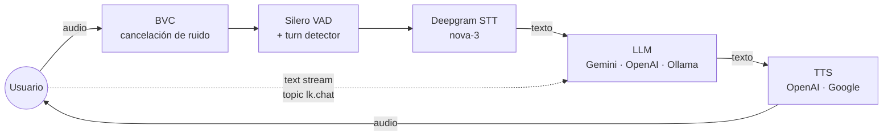

# godKAI-back

[](https://github.com/ahuertam/godkAI-back/actions/workflows/ci.yml)

Backend de agente conversacional con soporte de voz y texto. Carga su configuración desde `config.json` y el prompt desde `prompts/`.

#  Cómo funciona
En resumen, el flujo es así:
1. Tú hablas.
2. El STT (oído) escucha tu voz y la convierte en texto.
3. El LLM (cerebro) lee ese texto, piensa una respuesta y la escribe.
4. El TTS (boca) lee la respuesta del LLM en voz alta para que la escuches.
Estos tres componentes trabajan juntos en tiempo real para crear la ilusión de que estás conversando con una entidad inteligente.

## Arquitectura



- **Micrófono → sala**: el audio se publica en la sala de LiveKit; BVC limpia el ruido de fondo antes de transcribir.
- **STT**: Deepgram (`nova-3`, `es`) convierte el audio en texto.
- **LLM**: Gemini por defecto (`gemini-2.5-flash-lite`); configurable a OpenAI u Ollama.
- **TTS**: OpenAI (`gpt-4o-mini-tts`) o Google, aplicando `tts_instructions` como guía de estilo.
- **Voz y texto entran por la misma puerta**: el chat de texto llega como *text stream* en el topic `lk.chat` (`livekit.agents.types.TOPIC_CHAT`) y LiveKit lo encola como `generate_reply(user_input=...)`, igual que una frase hablada.

## Por qué estas decisiones

- **LiveKit Agents en vez de montar STT + LLM + TTS a mano**: la sala, el audio bidireccional, el VAD y la detección de turnos vienen resueltos, y cambiar de proveedor es cambiar una línea de config.
- **Config y prompts como ficheros** (`config.json`, `prompts/*.txt`): el comportamiento se versiona y se revisa como código. Una persona nueva = un `.txt` nuevo, sin tocar Python.
- **Personalidad separada del modelo**: el LLM es intercambiable, la personalidad no. Separarlas permite comparar prompts sobre el mismo modelo.
- **VAD (Silero) + turn detector multilingüe**: el VAD recorta el audio; el detector decide cuándo has terminado de hablar. Sin ellos el agente interrumpe o tarda demasiado.
- **`preemptive_generation`**: empieza a generar la respuesta mientras el usuario aún habla; se recorta la latencia percibida.
- **BVC (noise cancellation)**: quita ruido de teclado y ventiladores antes del STT; con micrófono real es la diferencia entre una transcripción usable y otra no.
- **Gemini para el LLM, OpenAI para el TTS**: por calidad/precio en voz en español cuando se escribió esto. Ambos se cambian desde `config.json`, sin código.


## Configuración Rápida

Para preparar el entorno de la aplicación, puedes usar el script de configuración incluido. Este script instalará las dependencias y descargará los modelos necesarios.

```bash
./setup.sh
```

## Requisitos
- Python 3.11+
- Servidor LiveKit accesible
- Credenciales:
  - `LIVEKIT_URL`, `LIVEKIT_API_KEY`, `LIVEKIT_API_SECRET`
  - `DEEPGRAM_API_KEY` (STT)
  - `OPENAI_API_KEY` (TTS)
  - `GOOGLE_API_KEY` (LLM Gemini)

## Instalación

Si prefieres una instalación manual, sigue estos pasos:

1. **Crea un entorno virtual:**
   ```bash
   python -m venv .venv
   source .venv/bin/activate
   ```

2. **Instala las dependencias:**
   ```bash
   uv sync
   ```
   (Las dependencias están en `pyproject.toml` + `uv.lock`. `package = false` en `[tool.uv]` evita que uv intente construir el proyecto: `agent.py` es un script, no un paquete instalable.)

3. **Descarga los modelos:**
   ```bash
   uv run agent.py download-files
   ```

## Configuración (`config.json`)
```json
{
  "agent_name": "godKAI",
  "base_instructions": "REGLAS INQUEBRANTABLES: 1. Siempre responde en español (castellano de España), sin excepciones. 2. Nunca uses inglés en tus respuestas. 3. Habla con un ritmo muy pausado y solemne.",
  "prompt": "gandalf",
  "llm_model": "gemini-2.5-flash-lite",
  "stt_model": "nova-3",
  "stt_language": "es",
  "tts_provider": "openai",
  "tts_model": "gpt-4o-mini-tts",
  "tts_voice": "onyx",
  "tts_instructions": "Voz masculina grave y profunda. Acento de España (castellano). Habla de forma pausada y solemne.",
  "preemptive_generation": true,
  "vad_min_speech_duration": 0.1,
  "vad_min_silence_duration": 0.3,
  "vad_padding_duration": 0.1
}
```
- `llm_provider` (opcional): `google` (por defecto), `openai` u `ollama`. Sin esta clave se usa Google y, si su plugin no está instalado, OpenAI. Ollama no tiene plugin propio: se habla con su API compatible con OpenAI (`llm_base_url`, por defecto `http://localhost:11434/v1`).
- `tts_provider`: `openai` o `google`.
- `prompt`: nombre de un `.txt` en `prompts/` (ej. `gandalf`).
- Si no existe, se usa `prompts/generic.txt`.
- Opcional `prompt_path`: ruta absoluta a un `.txt` externo (tiene prioridad sobre `prompt`).

## Prompts
- Coloca prompts en `prompts/` (`generic.txt`, `gandalf.txt`, etc.).
- Ejemplo `prompts/generic.txt`:
```text
Eres un agente conversacional.
Respondes de forma clara y breve.
Aceptas comandos por texto y consultas por voz.
Si no se proporcionan instrucciones específicas, mantén el contexto general.
```

## Variables de entorno
```env
LIVEKIT_URL=https://<tu-livekit-url>
LIVEKIT_API_KEY=<tu-api-key>
LIVEKIT_API_SECRET=<tu-api-secret>
DEEPGRAM_API_KEY=<tu-deepgram-key>
OPENAI_API_KEY=<tu-openai-key>
GOOGLE_API_KEY=<tu-google-key>
```

## Ejecución

Para ejecutar el agente, usa el comando `start`. Puedes usar el argumento `--config` para especificar un fichero de configuración del directorio `configs/`.

```bash
# Ejecutar con la configuración de Gandalf (Gemini)
uv run agent.py start --config gandalf

# Ejecutar con la configuración de Gandalf (Ollama)
uv run agent.py start --config gandalf_llama

# Ejecutar con la configuración por defecto (config.json)
uv run agent.py start
```

## Interacción
- **Texto**: envía un *text stream* con `topic: lk.chat` desde un cliente LiveKit. Es el topic que registra el propio LiveKit (`livekit.agents.types.TOPIC_CHAT`): el `RoomIO` lo encola como `generate_reply(user_input=...)`.
- **Voz**: conéctate a la sala; el agente detecta turnos (Silero VAD + turn detector) y responde con TTS.

## Personalización
- Ajusta modelos/idioma/voz en `config.json`.
- Cambia `base_instructions`.
- Usa `prompt_path` para reutilizar prompts externos.

## Troubleshooting
- Conexión: revisa `LIVEKIT_URL` y credenciales.
- STT/TTS: confirma `DEEPGRAM_API_KEY` y `OPENAI_API_KEY`.
- Prompt: verifica `prompts/<nombre>.txt` o `prompt_path`.

## Estructura
- `agent.py`: agente y sesión LiveKit
- `config.json`: configuración del agente
- `configs/`: configuraciones alternativas (`--config <nombre>`)
- `prompts/`: ficheros de prompt
- `tests/`: tests de configuración y prompts (`uv run pytest`)
- `.github/workflows/ci.yml`: CI (Python 3.11 / 3.12 / 3.13)

## Notas en detalle
- STT (Speech-to-Text / Habla a Texto):

- ¿Qué es? Es el "oído" del agente. Su única función es convertir el audio de la voz (lo que tú dices) en texto escrito.
- En nuestro proyecto: Cuando hablas con el agente, el sistema STT (Deepgram `nova-3`) transcribe tus palabras a texto para que el "cerebro" pueda entenderlas.
- LLM (Large Language Model / Gran Modelo de Lenguaje):

- ¿Qué es? Es el "cerebro" del agente. Es un modelo de inteligencia artificial muy avanzado (como `gemini-2.5-flash-lite`) que ha sido entrenado para entender y generar lenguaje humano.
- En nuestro proyecto: Una vez que el STT le pasa el texto de lo que dijiste, el LLM lo procesa, piensa en una respuesta siguiendo las instrucciones que le dimos (ser Gandalf, proteger el secreto, hablar en español, etc.) y genera una respuesta en formato de texto.
- TTS (Text-to-Speech / Texto a Habla):

- ¿Qué es? Es la "boca" o la "voz" del agente. Hace lo contrario del STT: toma un texto escrito y lo convierte en audio hablado.
- En nuestro proyecto: El sistema TTS (OpenAI `gpt-4o-mini-tts`, voz `onyx`; o Google, con `tts_voice_name`) recibe la respuesta en texto del LLM y la lee en voz alta, siguiendo las instrucciones de estilo de `tts_instructions` ( Voz masculina grave y profunda... ).

---

## 📄 Licencia

Apache-2.0. Ver [`LICENSE`](./LICENSE).

## 👤 Autor

**Alejandro Huerta** — Senior Frontend / Tools Engineer. Madrid (remoto).
[github.com/ahuertam](https://github.com/ahuertam) · [linkedin.com/in/alejandrohuertaengineer](https://linkedin.com/in/alejandrohuertaengineer)
